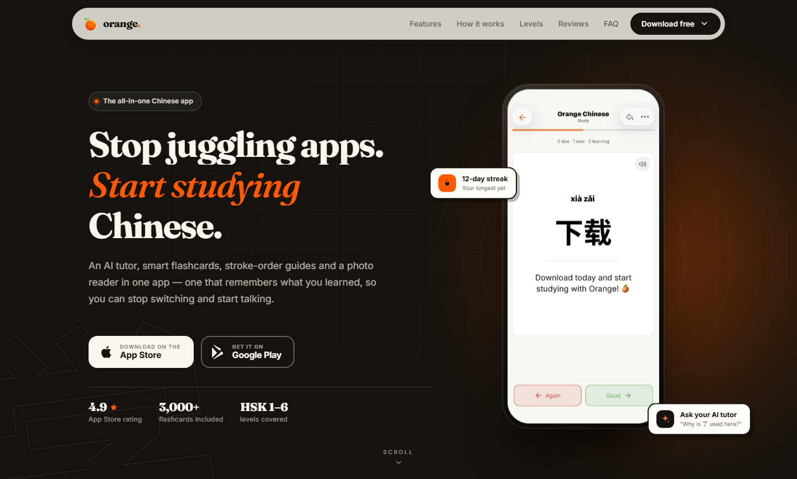

# orangechinese.net

The download funnel for **Orange Chinese** — a single-page site with one job: get a visitor from “what is this?” to the App Store or Google Play.



<p>
  
</p>

No framework, no build step. Open `index.html` and it runs.

## What's here

| Path | Purpose |
| --- | --- |
| `index.html` | The entire page — markup, design system and vanilla JS in one file |
| `assets/` | App icon, favicons, install icons, app screenshots and the 1200×630 social card |
| `assets/screen-flashcard.webp` | Flashcard screen used in the hero phone |
| `assets/screen-ai-chat.webp` | AI Tutor conversation used in the feature band |
| `assets/source-logo.png` | Master logo (transparent PNG) used to regenerate every icon |
| `assets/legacy/` | Older images kept for reference; not referenced by the page |
| `site.webmanifest` | Install metadata for Android / PWA |
| `robots.txt`, `sitemap.xml` | Crawler hints for the single canonical URL |
| `CNAME` | Custom domain for GitHub Pages |
| `scripts/build-assets.py` | Regenerates the icon set and `og-image.png` from the source logo |

## Preview locally

From this folder:

```powershell
python -m http.server 8099
# then open http://127.0.0.1:8099
```

(Look at it at a few widths — 390px, 768px and 1440px — because the hero, bento grid and sticky download bar all change layout.)

## Deploy

The site is static and deploys as-is:

1. Push the folder to the GitHub repository.
2. Settings → Pages → deploy from the branch root.
3. `CNAME` already points at `orangechinese.net`; enable “Enforce HTTPS”.

There is nothing to compile.

## Editing checklist

- **Store links** live in five places in `index.html` (hero, final CTA, footer, sticky mobile bar, and the `IOS_URL` / `PLAY_URL` constants in the script). Keep them in sync.
- **Regenerate assets** after changing the logo:

  ```powershell
  python scripts/build-assets.py
  ```

  Requires Pillow. It rewrites `assets/app-icon.png`, `icon-192.png`, `icon-512.png`, `icon-maskable-512.png`, `apple-touch-icon.png`, the favicons, `og-image.png` and `site.webmanifest`.

- **Update `sitemap.xml`** (`lastmod`) when meaningful content changes.
- **Product visuals:** the hero and AI Tutor cards use the supplied app captures (`assets/screen-flashcard.webp` and `assets/screen-ai-chat.webp`); the smaller feature vignettes are still HTML/CSS. Replace the two captures with new exports at the same aspect ratios when the app UI changes.
- **Before launch:** confirm the 4.9 rating, the 3,000+ flashcard count and the testimonial quotes are current and accurate. Add a privacy-policy link to the footer if the stores require a hosted copy.
